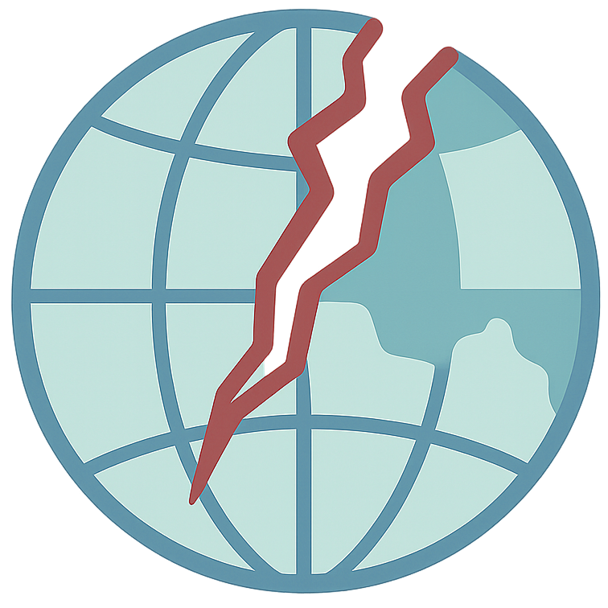

<table align="center"><tr><td align="center" width="9999">


# SCAR

**S**atellite-based **C**alibration for **A**erial **R**ecordings
</td></tr></table>

SCAR refines the intrinsics of an aerial camera and its extrinsics relative to a GNSS/INS from the
recording itself: it matches the images against georeferenced orthophotos, lifts the matches to 3D
anchors with a surface model and optimizes a factor graph (GTSAM) over cameras, anchors and the
calibration. No calibration target or ground control points are needed.

You provide images with timestamps, INS poses, an initial calibration and reference data:

- **Germany:** official orthophotos and DSMs of the federal states supported by
  [georaffer](https://github.com/michaelschleiss/georaffer) (NRW, RLP, BW, BY, BB, ...) are downloaded on
  demand.
- **Anywhere else:** your own orthophoto and surface model as GeoTIFF/COG/VRT in any CRS (e.g. NAIP +
  3DEP in the US, national mapping data, your own survey), or your own reference provider.

Frame cameras and event cameras (as reconstructed frames) are supported. The paper version is kept
frozen as the preset `cvprw2026` and the tag `v1.0.0-cvprw2026`.

## Installation

SCAR needs Python 3.11+.

```bash
git clone https://github.com/hlzmnhnry/scar.git && cd scar
pixi install            # environment with GTSAM, pyproj, rasterio, georay; CPU only
pixi install -e gpu     # + PyTorch/CUDA, learned matchers (vismatch), georaffer, rerun viewer
```

With pip: `pip install -e ".[references,matching,viewer]"` (add `germany` for German state data).
[georay](https://github.com/hlzmnhnry/georay) renders the reference views; the `germany` extra adds
georaffer.

## Quick start

A complete run on a synthetic flight with local GeoTIFF reference data, CPU only and without downloads:

```bash
pixi run python examples/custom_region_geotiff/make_demo_data.py examples/custom_region_geotiff/demo
pixi run scar run examples/custom_region_geotiff/config.yaml
pixi run python examples/custom_region_geotiff/make_demo_data.py --compare examples/custom_region_geotiff/demo
```

For your own flight:

```bash
scar init my_flight.yaml --template csv     # or: ltc, event
scar check my_flight.yaml --render          # time coverage, CRS, reference availability, footprint overlays
scar run my_flight.yaml --viewer            # collect anchors and optimize; live view in rerun
scar export runs/my_flight/calibration/calibration.yaml --format kalibr --output camchain.yaml
```

`scar collect` and `scar optimize` run the two steps separately; `scar evaluate` scores a calibration on
anchors of an independent test sequence (reprojection error, optionally visual localization). See
[`examples/`](examples) for an LTC campaign; `scar init --template event` starts an event camera setup.

## Inputs

All inputs are described in one YAML file; the templates in
[`scar/config/templates`](scar/config/templates) document every option.

| Input | Format |
| --- | --- |
| Images | CSV with timestamp and path, a directory of files named by timestamp, or LTC `camera.csv` |
| Poses | CSV with geodetic (lat, lon, height) or projected positions in any CRS; quaternion or Euler orientation w.r.t. NED or ENU; optional per-sample accuracies |
| Calibration | SCAR YAML, Kalibr camchain or LTC `camera.json`/`extrinsics.json`; pinhole with radial-tangential distortion |
| Reference data | georaffer regions (Germany) or local orthophoto and DSM rasters |

Poses are interpolated to the image timestamps (linear position, SLERP rotation), optionally with a
time offset. The conventions for frames, heights, datums and the meridian convergence are described in
[docs/coordinate_systems.md](docs/coordinate_systems.md); please read it before using your own data.

## Outputs

A run directory contains the anchors (`anchors.json`), the per-stage results (`calibration/stages.json`),
the final calibration with the marginal covariance of the intrinsics (`calibration/calibration.yaml`)
and, with `--viewer`, a rerun recording. `scar export` writes Kalibr, OpenCV and LTC formats.

## Optimization presets

| Preset | Description |
| --- | --- |
| `default` | Staged schedule of the paper (rotation, translation, landmarks, calibration, full) followed by a least-squares fit of the extrinsics; use with the corrected pose processing (default of all templates) |
| `cvprw2026` | Frozen paper configuration; together with `paper/cvprw2026` it reproduces the published results |
| `joint` | Experimental: extrinsics as a variable of the factor graph instead of the least-squares fit |

## Reproducing the paper

[`paper/cvprw2026`](paper/cvprw2026) contains the scripts, campaign definitions and initial calibrations
of the CVPRW 2026 evaluation, the reproduction log and an ablation of geodetic corrections that were not
part of the paper version (float32 coordinates, meridian convergence, heights, interpolation).
The meridian convergence correction alone lowers the test reprojection error by 21 % on average over the
six LTC campaigns.

## Development

```bash
pixi run test           # unit, synthetic and system tests; regression tests need local LTC data
pixi run -e repro test  # bit-exact paper regression with GTSAM 4.2.0
```

## Citation

If you use SCAR in academic work, please cite:

```bibtex
@InProceedings{Holzemann_2026_CVPR,
    author    = {H\"olzemann, Henry and Schleiss, Michael},
    title     = {SCAR: Satellite Imagery-Based Calibration for Aerial Recordings},
    booktitle = {Proceedings of the IEEE/CVF Conference on Computer Vision and Pattern Recognition (CVPR) Workshops},
    month     = {June},
    year      = {2026},
    pages     = {987-996}
}
```

Reference data obtained through georaffer are subject to the licenses of the respective providers
(e.g. NRW: dl-de/zero-2.0, RLP: dl-de/by-2.0); SCAR does not redistribute them.
